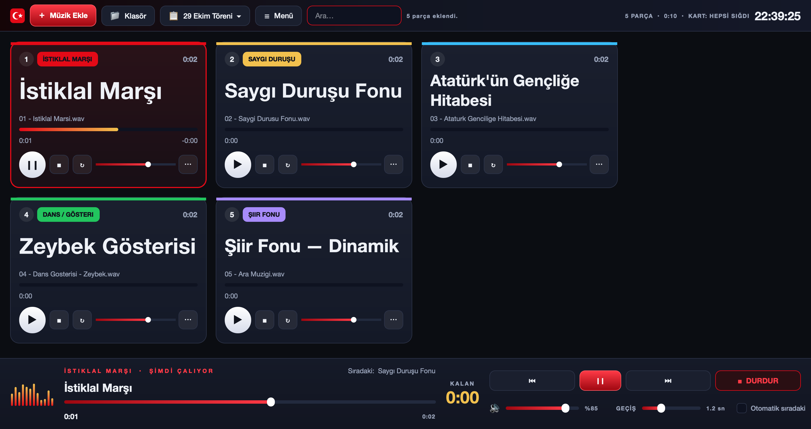
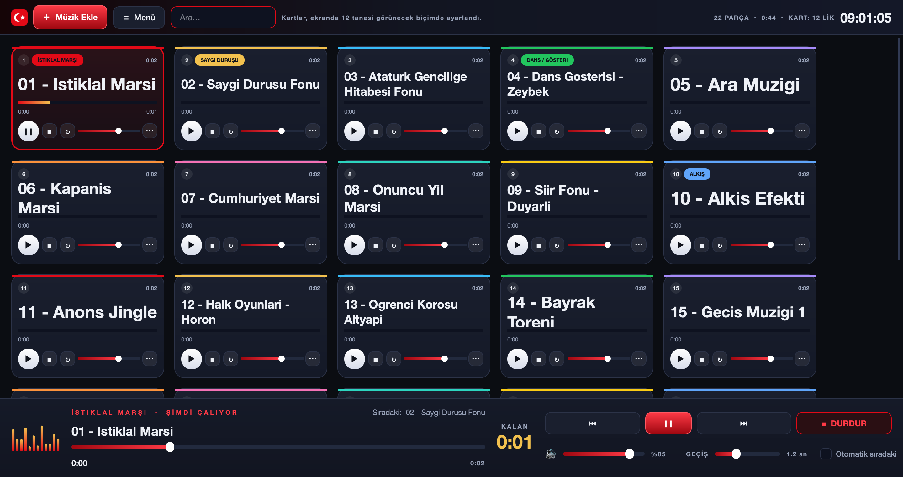

# 🇹🇷 Cumhuriyet Ses Konsolu

29 Ekim Cumhuriyet Bayramı kutlamasında **sahne seslerini yöneten** masaüstü uygulaması.
Her müzik ekranda bir **kart** olur; kartın üzerinden çalınır, duraklatılır, devam ettirilir.
Windows, macOS ve Linux'ta çalışır; her üçü için de tek dosyalık paket üretilebilir.

Çok parçalı program, “Sığdır” ile tek ekranda:

---

## Kurulum

### A) Hazır tek dosya (önerilen — Python gerekmez)

**İndirme:** <https://github.com/msoguz44/cumhuriyet-ses-konsolu/releases/tag/v1.0>
(depo özel olduğu için indirirken GitHub hesabınızla giriş yapmış olmanız gerekir)

| İşletim sistemi | Dosya | Nasıl açılır |
|---|---|---|
| **Windows** | `CumhuriyetSesKonsolu.exe` | Çift tıklayın. İlk açılışta SmartScreen uyarırsa **Daha fazla bilgi → Yine de çalıştır**. |
| **macOS** | `CumhuriyetSesKonsolu-mac.dmg` | DMG'yi açıp uygulamayı **Applications**'a sürükleyin. İlk açılışta uygulamaya **sağ tık → Aç** deyin (imzasız uygulama uyarısı için). |
| **Linux** | `CumhuriyetSesKonsolu` (ya da `.AppImage`) | `chmod +x CumhuriyetSesKonsolu` sonra çift tıklayın / `./CumhuriyetSesKonsolu`. |

### B) Bu paketleri nasıl üretirsiniz

> Her paket **kendi işletim sisteminde** üretilir: Windows `.exe`'si Mac'te,
> Mac `.dmg`'si Windows'ta üretilemez.

**En kolay yol — GitHub Actions (tek bilgisayarla üçünü birden):**
depo zaten GitHub'da: <https://github.com/msoguz44/cumhuriyet-ses-konsolu>.
**Actions → “Paketler (Windows · macOS · Linux)” → Run workflow** deyin. Birkaç dakika sonra üç paket de sayfanın altındaki **Artifacts** bölümünden iner.
`v1.0` gibi bir etiket gönderirseniz paketler doğrudan **Releases**'e de eklenir.

**Kendi bilgisayarınızda:**

| Platform | Komut |
|---|---|
| Windows | `paket\windows_exe.bat` dosyasına çift tıklayın |
| macOS | `bash paket/mac_dmg.sh` |
| Linux | `bash paket/linux_tek_dosya.sh` |

Çıktılar `dist/` klasörüne düşer. (AppImage istiyorsanız `appimagetool` kurulu olsun;
yoksa tek dosyalık çalıştırılabilir yine üretilir.)

### C) Python ile çalıştırma (kaynaktan)

1. [python.org/downloads](https://www.python.org/downloads/) — kurarken **“Add Python to PATH”** işaretli olsun.
2. Windows'ta **`Baslat.bat`**, macOS'ta **`baslat.command`** dosyasına çift tıklayın.
   Gerekli paket (PySide6) ilk açılışta kendiliğinden kurulur.
   Terminalden: `pip install PySide6 && python main.py`

## Kullanım

| İş | Nasıl |
|---|---|
| Müzik ekleme | **＋ Müzik Ekle** düğmesi, **☰ Menü → Klasör ekle** ya da dosyaları pencereye **sürükleyip bırakma** |
| Çal / duraklat | Kartın üzerindeki büyük ▶ düğmesi (ya da karta çift tıklama) |
| Devam ettirme | Aynı düğmeye tekrar basmak — parça kaldığı yerden devam eder |
| Durdurma | Karttaki ■ düğmesi veya alttaki kırmızı **DURDUR** (ses yumuşakça kısılır) |
| Sıra değiştirme | Kartı tutup başka bir kartın üzerine **sürükleyip bırakın**; boş alana bırakılan kart listenin sonuna gider |
| Kart boyutu | **☰ Menü → Kart boyutu → Büyüt / Küçült** (ya da Ctrl + / Ctrl −) |
| Ekrana sığdırma | **☰ Menü → Kart boyutu → Hepsini sığdır** ya da *Ekranda 12 / 20 / 30 / 40 kart* |
| Program kaydet/yükle, süre okuma, tam ekran | hepsi **☰ Menü** altında |
| Ad / etiket / renk | Kartın sağ altındaki **⋯** düğmesi veya karta **sağ tık** |
| Parçanın kendi sesi | Karttaki küçük ses sürgüsü (konuşma üstüne fon müziği için ideal) |
| Belirli saniyeden başlatma | Parçayı çalın, istediğiniz yere gelin, **⋯ → Başlangıcı buraya al** |
| Arama | Üst şeritteki arama kutusu (Ctrl+F) |

### Klavye kısayolları (tören sırasında en hızlı yol)

| Tuş | İş |
|---|---|
| **Boşluk** | Duraklat / devam ettir |
| **1 – 9, 0** | O sıradaki kartı çal (0 = 10. kart) |
| **Esc** | ACİL: sesi yumuşakça kıs ve durdur |
| **K** | Anında kes (geçiş yok) |
| **N / P** | Sonraki / önceki parça |
| **← →** | 5 sn geri / ileri  ·  **Shift** ile 30 sn |
| **↑ ↓** | Ana sesi %5 arttır / azalt |
| **Ctrl + +** / **Ctrl + −** | Kartları büyüt / küçült |
| **Ctrl + 0** | Kart boyutunu varsayılana döndür |
| **Ctrl + Shift + F** | Bütün kartları ekrana sığdır |
| **F11** | Tam ekran |
| **F1** | Kısayol yardımı |

---

## Ekranı müziklere ayırmak

Üst şerit tek satırlıktır: solda **＋ Müzik Ekle**, **☰ Menü** ve arama kutusu, sağda özet
bilgi ile saat vardır. Diğer bütün işlemler (klasör ekleme, kart boyutu, program kaydetme,
süre okuma, tam ekran, yardım) **☰ Menü** altındadır; böylece ekranın neredeyse tamamı
kartlara kalır. **F11** ile tam ekrana geçerseniz birkaç kart daha sığar.

## Kart boyutu ve "ekrana sığdır"

**☰ Menü → Kart boyutu** altından *“Ekranda 20 kart görünsün”* dediğinizde uygulama,
pencerenin o anki boyutuna bakıp 20 kartın kaydırmadan sığacağı en büyük boyutu seçer.
Kartlar küçüldükçe sırasıyla dosya adı, süre satırı ve ses sürgüsü gizlenir; **müziğin adı,
sıra numarası, ilerleme çubuğu ve çal düğmesi her boyutta kalır.** Müziğin adı kartın en
baskın yazısıdır: her kart, adı kendi kutusuna sığan **en büyük punto** ile yazar, uzun adlar
iki satıra kayar. Küçük kartlarda gizlenen döngü ayarına kartın **⋯** menüsünden ulaşabilirsiniz.

Seçtiğiniz tercih kaydedilir: uygulamayı yeniden açtığınızda ya da pencereyi
büyütüp küçülttüğünüzde kartlar kendiliğinden yeniden ayarlanır.
Tipik bir 1920×1080 ekranda 20 kart, adları rahat okunacak boyutta sığar.

## Tören için küçük notlar

* **Geçiş** sürgüsü, sesin açılma/kapanma yumuşaklığıdır. 1–2 saniye arası,
  hoparlörde “pat” diye kesilmeyi önler. Marşlar için 0'a (kapalı) almak daha doğru olabilir.
* **Otomatik sıradaki** kutusu işaretliyse parça bitince listedeki bir sonraki parça
  kendiliğinden başlar. Törende genellikle **kapalı** kalması daha güvenlidir.
* **Döngü** (↻) düğmesi, fon müziğini bitmeden tekrarlatır.
* Liste ve bütün ayarlar **kendiliğinden kaydedilir**; program kapansa bile kaybolmaz.
  Ayrıca **☰ Menü → Programı dosyaya kaydet** ile yedek alıp başka bilgisayara taşıyabilirsiniz.
* Müzikleri tören bilgisayarında **tek bir klasörde** tutun. Dosya taşınırsa kart
  “Dosya bulunamadı” uyarısı verir; **⋯ → Dosyayı yeniden bağla** ile düzeltilir.
* Desteklenen biçimler: mp3, wav, m4a, aac, flac, ogg, wma, aiff, opus.
  En güvenlisi **mp3** ve **wav**'dır.

---

## Dosyalar

| Dosya | İçerik |
|---|---|
| `main.py` | Uygulamanın giriş noktası |
| `pencere.py` | Ana pencere: üst şerit, kart tahtası, alt ses konsolu |
| `kart.py` | Müzik kartı |
| `ses_motoru.py` | Çalma motoru, yumuşak açılma/kapanma |
| `depo.py` | Parça verisi, program kaydı, süre okuma |
| `tema.py` | Renkler ve görsel stil |
| `gorsel.py`, `simge.py`, `akis_duzeni.py`, `yardimci.py` | Yardımcı bileşenler |
| `paket/` | Simge dosyaları, PyInstaller tarifi ve platform paketleme betikleri |
| `.github/workflows/paket.yml` | Üç platformun paketini birlikte üreten GitHub akışı |
